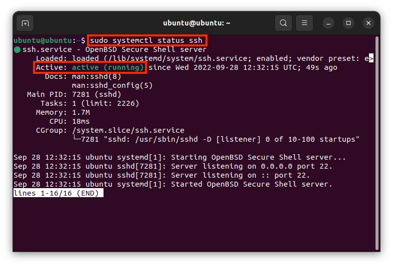
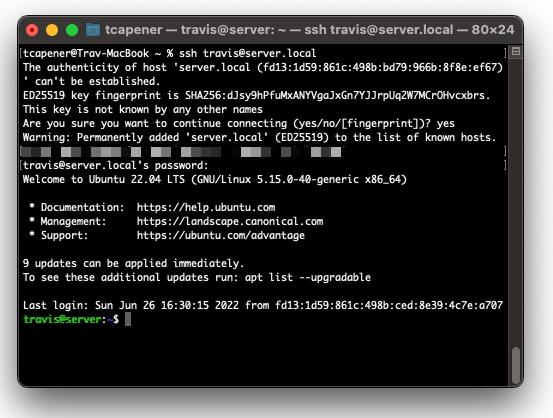
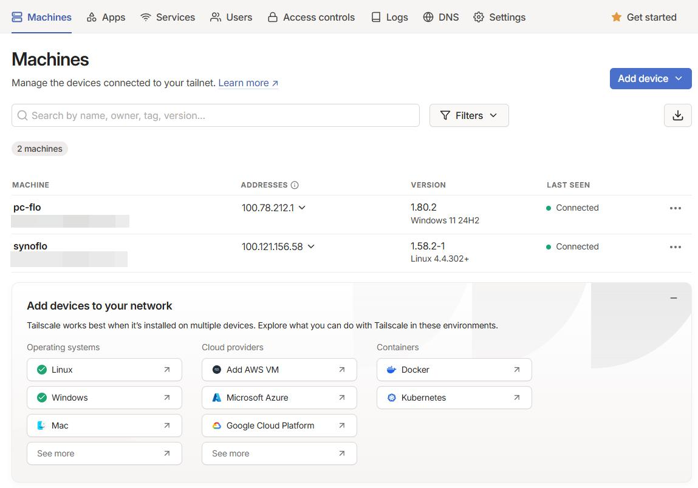
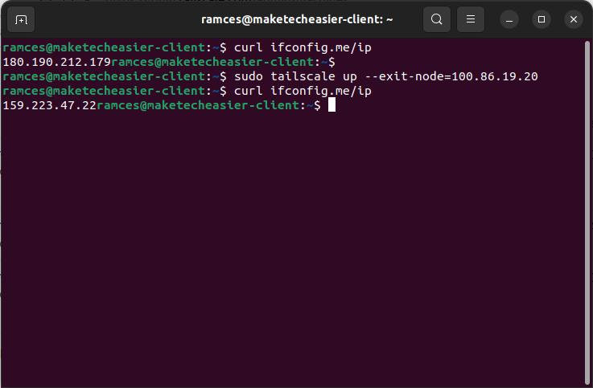
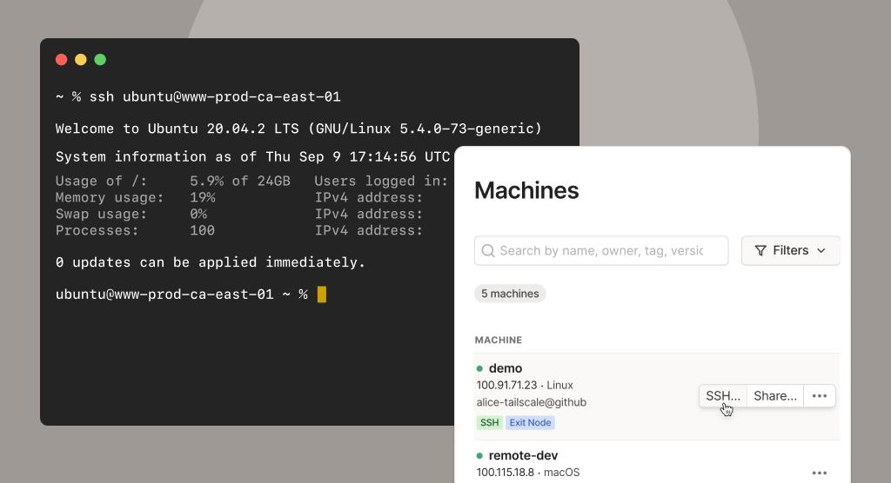

# Linux SSH & Tailscale Remote Access Lab

## 1. Project Overview

### Objective

The purpose of this lab is to learn how to remotely access an Ubuntu Linux virtual machine using SSH (Secure Shell), first over a local network and then securely across different networks using Tailscale.

This project demonstrates practical knowledge of:

- Linux administration
- SSH configuration
- Linux services using systemctl
- Network connectivity
- Remote server administration
- Tailscale VPN networking
- Git and GitHub documentation

## 2. Lab Environment

| Device | Operating system | Purpose |
|---|---|---|
| MacBook | macOS | SSH client |
| Ubuntu VM | Ubuntu Linux | Remote SSH server |
| Friend's computer | Windows, macOS, or Linux | Remote access client |

**Network setup:**

- Ubuntu runs as a virtual machine.
- The MacBook connects to Ubuntu using SSH.
- Tailscale connects devices through a private encrypted network.
- The friend can be on a completely different internet connection.

## 3. Part One: Configure SSH on Ubuntu

### Step 1: Install the SSH server

On the Ubuntu VM, open Terminal and run:

```bash
sudo apt update
```

Install OpenSSH Server:

```bash
sudo apt install openssh-server -y
```

### Step 2: Start the SSH service

```bash
sudo systemctl start ssh
```

Enable SSH to start automatically when Ubuntu restarts:

```bash
sudo systemctl enable ssh
```

### Step 3: Verify SSH status

```bash
sudo systemctl status ssh
```

Expected status:

```text
Active: active (running)
```

### Step 4: Understand SSH port 22

SSH normally uses TCP port 22.

Check whether SSH is listening:

```bash
sudo ss -tlnp | grep ':22'
```

If UFW (Ubuntu Firewall) is enabled, check its status:

```bash
sudo ufw status
```

If needed, allow SSH through UFW:

```bash
sudo ufw allow OpenSSH
```

**Important:** Starting the SSH service and allowing traffic through the Linux firewall are two different things. Router port forwarding is not required for the Tailscale setup.

## 4. Part Two: Connect to Ubuntu from macOS

On the MacBook, open the macOS Terminal.

The SSH command follows this format:

```bash
ssh USERNAME@UBUNTU_IP_ADDRESS
```

Replace the username and IP address with your actual Ubuntu login username and Ubuntu VM IP address.

Example:

```bash
ssh olvin@192.168.1.100
```

The first time you connect, SSH may ask whether you trust the host.

Type:

```text
yes
```

Enter your Ubuntu password when prompted.

You should now have a remote terminal session into your Ubuntu VM.

To disconnect:

```bash
exit
```

## 5. Part Three: Install Tailscale

### Why Tailscale?

Tailscale creates a private, encrypted network between authorized devices.

It allows computers on different networks to communicate without requiring traditional router port forwarding.

For example:

- Your MacBook can be at home.
- Your Ubuntu VM can be at home.
- Your friend can be at another location.
- Authorized devices can communicate through Tailscale.

### Step 1: Create a Tailscale account

Visit:

https://tailscale.com/

Create an account and access the Tailscale admin console.

### Step 2: Install Tailscale on macOS

Download the macOS installer from the official Tailscale website.

Install the application and sign in.

Approve the required macOS VPN and network permissions.

Verify that your MacBook appears in the Tailscale admin console.

### Step 3: Install curl on Ubuntu

If curl is not already installed:

```bash
sudo apt update
```

```bash
sudo apt install curl -y
```

### Step 4: Install Tailscale on Ubuntu

Run the official installation command:

```bash
curl -fsSL https://tailscale.com/install.sh | sh
```

### Step 5: Connect Ubuntu to Tailscale

Run:

```bash
sudo tailscale up
```

A login URL should appear.

Copy the URL into your MacBook's web browser and authorize Ubuntu using the same Tailscale account.

### Step 6: Retrieve Ubuntu's Tailscale IP

Run:

```bash
tailscale ip -4
```

This displays the private Tailscale IPv4 address assigned to Ubuntu.

Tailscale IPv4 addresses typically fall within the `100.64.0.0/10` range.

You can also see your Ubuntu VM listed in the Tailscale admin console.

## 6. Part Four: SSH Through Tailscale

Now that both your MacBook and Ubuntu VM are connected to Tailscale, you can SSH into Ubuntu using its Tailscale IP address.

On your MacBook, open Terminal and run:

```bash
ssh USERNAME@TAILSCALE_IP
```

Example:

```bash
ssh olvin@100.x.x.x
```

Replace the example IP with your actual Ubuntu Tailscale IP.

Enter your Ubuntu password if prompted.

You should now be connected to your Ubuntu VM through Tailscale.

### What makes this different?

Previously, SSH worked over your local network using the Ubuntu VM's local IP address.

With Tailscale, you can use its private Tailscale IP even when the devices are on different internet connections.

You do not need to expose SSH port 22 to the public internet or configure router port forwarding.

## 7. Part Five: Allow a Friend to Connect

The original goal was to allow a friend on a different network to SSH into the Ubuntu VM.

The friend needs to:

1. Install Tailscale on their computer.
2. Create their own Tailscale account.
3. Accept access to the Ubuntu device through Tailscale device sharing, or receive access through an appropriately configured shared network.
4. Have permission to reach the Ubuntu VM.
5. Connect using SSH and the Ubuntu VM's Tailscale IP.

Example:

```bash
ssh USERNAME@TAILSCALE_IP
```

**Security reminder:** Do not share your Tailscale account password. Share access to the Ubuntu device with your friend and grant only the permissions they need. For additional security, consider SSH keys instead of password authentication.

## 8. Troubleshooting

### Problem: curl command not found

Solution:

```bash
sudo apt install curl -y
```

### Problem: SSH connection refused

Check SSH status:

```bash
sudo systemctl status ssh
```

Start SSH:

```bash
sudo systemctl start ssh
```

Check whether port 22 is listening:

```bash
sudo ss -tlnp | grep ':22'
```

### Problem: Permission denied

Verify that you are using the correct Ubuntu username and password, or the correct SSH key.

### Problem: Cannot connect through Tailscale

Check Tailscale status:

```bash
tailscale status
```

Check the Ubuntu Tailscale IP:

```bash
tailscale ip -4
```

Make sure both devices are online and authorized to communicate.

## 9. Important Commands Reference

| Command | Purpose |
|---|---|
| `sudo apt update` | Refresh package information |
| `sudo apt install openssh-server -y` | Install SSH server |
| `sudo systemctl start ssh` | Start SSH |
| `sudo systemctl enable ssh` | Enable SSH at startup |
| `sudo systemctl status ssh` | Check SSH status |
| `sudo ss -tlnp` | View listening network ports |
| `sudo apt install curl -y` | Install curl |
| `curl -fsSL https://tailscale.com/install.sh \| sh` | Install Tailscale |
| `sudo tailscale up` | Connect Ubuntu to Tailscale |
| `tailscale status` | View Tailscale devices |
| `tailscale ip -4` | Display Tailscale IPv4 |
| `ssh USERNAME@IP_ADDRESS` | Connect remotely using SSH |
| `exit` | End SSH session |

## 10. What I Learned

Through this lab, I gained practical experience with:

- Installing and configuring OpenSSH Server on Ubuntu.
- Managing Linux services with systemctl.
- Understanding TCP port 22 and SSH connectivity.
- Connecting to a Linux VM remotely from macOS Terminal.
- Installing and configuring Tailscale.
- Understanding private encrypted device networking.
- Connecting devices across different networks without router port forwarding.
- Troubleshooting SSH connection problems.

## 11. Conclusion

This project demonstrates how to configure a Linux server for remote administration using SSH and Tailscale.

The first phase established an SSH connection between a MacBook and an Ubuntu virtual machine. The second phase introduced Tailscale to securely connect devices across different networks without exposing SSH directly to the public internet.

This lab provides a foundation for further learning in Linux administration, networking, cybersecurity, and DevOps.

## 12. Future Improvements

- Configure SSH key-based authentication.
- Create a separate Linux user for remote administration.
- Configure Tailscale access controls.
- Test remote connectivity from another physical network.
- Monitor SSH authentication logs.
- Expand the lab with Docker and Nginx.
- Automate server configuration using Bash scripts.

  ## Screenshots

### 1. SSH Service Running on Ubuntu
Shows that the SSH service is active and running.



### 2. Successful SSH Connection from MacBook
Shows the initial SSH connection from your MacBook to Ubuntu.



### 3. Tailscale Installation and IP Address
Shows Tailscale installed and the private Tailscale IP assigned to Ubuntu.



### 4. Tailscale Devices Connected
Shows the MacBook and Ubuntu VM registered in Tailscale.



### 5. Remote SSH Connection Using Tailscale
Shows the successful remote SSH connection using the Tailscale IP.


